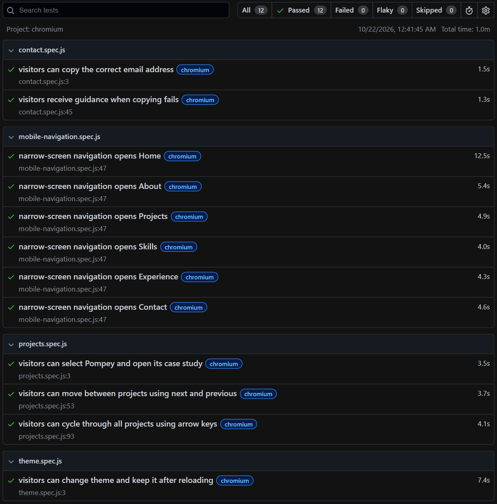

# Quynh Trang Nguyen - Web Developer Portfolio

A personal portfolio built with React and Vite to present my web development, software testing and UX/UI project work.

Explore project previews, detailed case studies and the experience behind my work.

[View portfolio](https://my-portfolio-ivory-ten-46.vercel.app/) · [LinkedIn](https://www.linkedin.com/in/quynh-trang-nguyen-21a559334/)

## Portfolio features

- **Interactive project gallery:** layered previews, previous/next controls and a project selector alongside the active summary. Gallery controls support keyboard navigation.
- **Project case studies:** dedicated pages covering context, individual contributions, design decisions, implementation, evaluation and reflection, with section navigation and scroll-based active states.
- **Responsive themes:** layouts for desktop, tablet and mobile, with light and dark modes and a saved theme preference.
- **Accessibility-aware interactions:** semantic markup, visible focus states, descriptive controls and reduced-motion support.
- **Skills in context:** grouped skills with information controls explaining how I have applied them. Context panels support hover, keyboard focus and touch, with Escape-key and outside-click dismissal.
- **Image exploration:** enlarged case-study images with zoom and Escape-key dismissal, plus a programme-logo preview within professional experience.
- **Professional background:** experience, education and certifications, with links to available online certificates.
- **Contact options:** email, LinkedIn and GitHub, plus an email-copy control with success and failure feedback.
- **Maintainable styling:** shared CSS colour variables named by purpose, reusable components and incremental TypeScript adoption.
- **Browser testing:** Playwright tests covering gallery interactions, case-study navigation, clipboard feedback, theme persistence and section navigation at a narrow viewport.

## Technology stack

| Area | Technologies |
| --- | --- |
| Interface | React, JavaScript (ES6+), TypeScript, HTML5, CSS3 |
| Routing and icons | React Router, React Icons |
| Browser testing | Playwright Test, Chromium |
| Development | Vite, npm, ESLint, Git and GitHub |
| Hosting | Vercel |

TypeScript is adopted incrementally. `Skills.tsx` types skill data and information-control interactions. `ProjectSectionNav.tsx` types navigation props, DOM refs and events. `SkillsTagline.tsx` uses a typed paragraph ref for its animated tagline. The remaining application components currently use JavaScript. Playwright configuration and test files also use JavaScript.

## Projects showcased

These summaries describe the projects presented on the site. Their backend technologies and Jest/Supertest tests belong to the separate applications. This portfolio repository uses Playwright for browser testing, as documented below.

### Healthcare Booking System

**Individual MSc dissertation project · Full-stack prototype**

An academic prototype exploring more flexible GP appointment discovery and booking using simulated data. Features include city-wide appointment search, rule-based scheduling suggestions, administrator-approved appointment swaps, conflict detection, Google Calendar synchronisation, email notifications and role-based access controls.

**My contribution:** requirements research, user journeys, interface design, application and database development, and testing.

**Technologies:** JavaScript, Node.js, Express.js, PostgreSQL, EJS, Bootstrap, Google Calendar API, OAuth 2.0, Nodemailer and Brevo SMTP. Automated tests use Jest and Supertest.

**Evaluation:** requirements-based manual checks and local Lighthouse audits, supplemented by 27 automated tests across four suites. Tests cover authentication middleware, scheduling rules and selected booking, swap and administrative routes. Regression checks address a bug where the string `"false"` incorrectly triggered an urgent scheduling result.

Database queries and external services are mocked in the automated tests; live integrations are not tested end to end. This is a prototype, not a deployed clinical service.

[Read the healthcare case study](https://my-portfolio-ivory-ten-46.vercel.app/projects/healthcare-booking-system)

### Pompey Furniture Company

**Team project · Full-stack retail prototype**

A database-driven application for a fictional multi-showroom furniture retailer. It supports stock, customer orders, returns, delivery information, loyalty and coupons, employee operations and role-based workflows.

**My contribution:** project coordination, relational database design, SQL reporting and application integration. After team delivery, I independently improved password storage, session authentication, server-side authorisation, record-ownership checks, environment configuration and Stripe Checkout data validation.

**Technologies:** Node.js, Express.js, PostgreSQL, SQL, JavaScript, HTML5, CSS3 and Stripe Checkout.

**Evaluation:** SQL query checks and HTML/CSS standards validation are documented in the case study. Payments use Stripe test mode.

[Read the furniture case study](https://my-portfolio-ivory-ten-46.vercel.app/projects/furniture-retail-management-system)

### Hampshire Festival App

**Team project · UX/UI design prototype**

Explores festival discovery, personal planning and event management for visitors, event staff, exhibitors and administrators.

**My contribution:** user analysis, personas, use cases, Hierarchical Task Analysis, low-fidelity design and heuristic evaluation. I independently created the high-fidelity Figma prototype from the team's research and proposed task flows.

**Tools and methods:** Figma, Miro, draw.io, personas, task modelling, use cases, prototyping and heuristic evaluation.

**Evaluation:** reviewed using usability heuristics. The outcome is a design prototype; evaluation did not include participant testing.

[Read the festival case study](https://my-portfolio-ivory-ten-46.vercel.app/projects/hampshire-festival-app)

The gallery also includes this React portfolio, with a direct link to its [source code](https://github.com/quhtrang-cloud/my-portfolio). Its implementation and testing are documented in this repository.

## Repository structure

| Path | Purpose |
| --- | --- |
| `public/` | Public assets, downloadable CV, favicon and `robots.txt` |
| `src/assets/` | Portrait, project screenshots, experience assets and the README test-report image |
| `src/components/` | Home sections and shared navigation, theme, motion and interaction components |
| `src/pages/` | Case-study pages: `HealthcareProject.jsx`, `FurnitureProject.jsx` and `HampshireFestivalProject.jsx` |
| `src/App.jsx` | Application routes and home layout |
| `src/App.css` | Shared colour variables, portfolio and case-study styles |
| `src/index.css` | Global base styles |
| `src/main.jsx` | Application entry point |
| `tests/e2e/` | Playwright tests for projects, contact, theme and narrow-screen navigation |
| `playwright.config.js` | Browser, local server, reporting and worker configuration |
| `tsconfig.json` | TypeScript configuration for gradual migration |
| `eslint.config.js` | ESLint configuration |
| `vite.config.js` | Vite configuration |
| `vercel.json` | Deployment configuration |
| `package.json` | Project dependencies and npm scripts |
| `package-lock.json` | Locked dependency versions for reproducible installation |
| `index.html` | HTML entry point |
| `.gitignore` | Excludes dependencies, build output, local configuration and generated test results |

The production build generates `dist/`; dependency installation generates `node_modules/`. Playwright generates `playwright-report/` and `test-results/` when tests run. These generated directories are excluded from Git.

## Run locally

Install a Node.js version compatible with the project's Vite and Playwright versions, together with npm, then run:

```bash
git clone https://github.com/quhtrang-cloud/my-portfolio.git
cd my-portfolio
npm ci
npm run dev
```

Vite prints the local development URL in the terminal.

## Checks and production build

| Command | Purpose |
| --- | --- |
| `npm run typecheck` | Runs `tsc --noEmit` without generating JavaScript output |
| `npm run build` | Runs the configured type checks and creates an optimised build in `dist/` |
| `npm run preview` | Serves the production build locally for review |

JavaScript files are not type-checked while `checkJs` is disabled. Type checking and the production build are separate from the Playwright test run.

## Portfolio testing

The portfolio currently includes **12 Playwright tests across four spec files**, run on Chromium against the local application.

| Spec file | Tests | Scope |
| --- | ---: | --- |
| `projects.spec.js` | 3 | Select Pompey and open its case study; use Next/Previous controls; cycle through all four projects in both directions using arrow keys, including wraparound |
| `contact.spec.js` | 2 | Copy the correct email address and display success feedback; display guidance and keep the control usable when a clipboard write is rejected |
| `theme.spec.js` | 1 | Switch between light and dark themes and preserve each selection after reloading |
| `mobile-navigation.spec.js` | 6 | Check each navbar link at a 390 × 844 viewport, including its destination, target heading in the viewport and active navigation state |

The successful clipboard test uses the browser's clipboard API with permissions granted in the test context. The failure test simulates a rejected clipboard write to exercise error handling.

The narrow-screen tests use a resized Chromium viewport. They check navigation behaviour rather than complete mobile-device compatibility or visual layout quality. The suite also does not establish full accessibility conformance; visual review, keyboard exploration and testing on other browsers and real devices remain separate checks.

### Run the browser tests

After installing the project dependencies, install the test browser:

```bash
npx playwright install chromium
```

Run all tests:

```bash
npx playwright test
```

The configuration starts the Vite development server at `http://127.0.0.1:5173`, or reuses an existing server at that address outside CI. Tests run sequentially with `workers: 1` to reduce resource contention during local testing.

Useful commands:

| Command | Purpose |
| --- | --- |
| `npx playwright test --headed` | Runs tests with the browser window visible |
| `npx playwright test tests/e2e/contact.spec.js` | Runs the contact tests only |
| `npx playwright test --list` | Lists the discovered tests without running them |
| `npx playwright show-report` | Opens the latest HTML report |

Traces are retained for failed tests. Use the `npx playwright show-trace` command and trace path printed with a failure to inspect the recorded run. Inspect or save failure evidence before running the suite again, as a new run can replace previous test output.

Generated reports and test results are excluded from Git. The screenshot below is a static example of a local run, rather than a live CI status.

<details>
<summary>View an example Playwright test report</summary>



Example local run covering gallery interactions, case-study navigation, clipboard feedback, theme persistence and section navigation at a narrow viewport.

</details>

## Deployment

The portfolio is hosted on Vercel, with automatic deployment from the connected GitHub repository's `main` branch. React Router provides the home and case-study routes.

The Playwright commands above run locally. Automated test execution through GitHub Actions has not yet been configured.

## Author

**Quynh Trang Nguyen**

[Portfolio](https://my-portfolio-ivory-ten-46.vercel.app/) · [LinkedIn](https://www.linkedin.com/in/quynh-trang-nguyen-21a559334/)
