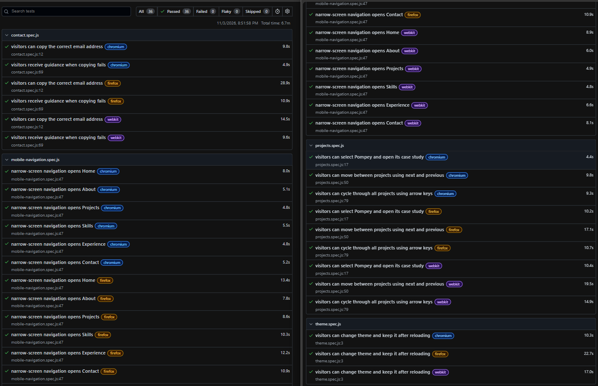

# Quynh Trang Nguyen - Web Developer Portfolio

A personal portfolio built with React and Vite to present my web development, software testing and UX/UI project work.

Explore project previews, detailed case studies and the experience behind my work.

[View portfolio](https://my-portfolio-ivory-ten-46.vercel.app/) · [LinkedIn](https://www.linkedin.com/in/quynh-trang-nguyen-21a559334/)

## Portfolio features

- **Interactive project gallery:** six projects with a featured three-preview layout for Healthcare, a selectable project list, and previous/next controls that wrap between the first and last projects. Controls are operable by keyboard.

- **Project case studies:** dedicated pages covering context, individual contributions, design decisions, implementation, evaluation and reflection, with section navigation and scroll-based active states.

- **Responsive themes:** layouts for desktop, tablet and mobile, with light and dark modes and a saved theme preference.

- **Motion and visual details:** custom SVG animations, typewriter effects and handwritten-style notes add personality to the interface, with reduced-motion considerations.

- **Accessibility-aware interactions:** semantic markup, visible focus states, descriptive controls and reduced-motion support.

- **Skills in context:** grouped skills with information controls explaining how I have applied them. Context panels support hover, keyboard focus and touch, with Escape-key and outside-click dismissal.

- **Image exploration:** enlarged case-study images with zoom and Escape-key dismissal, plus a programme-logo preview within professional experience.

- **Professional background:** experience, education and certifications, with links to available online certificates.

- **Contact options:** email, LinkedIn and GitHub, plus an email-copy control with success and failure feedback.

- **Maintainable styling:** shared CSS colour variables named by purpose, reusable components and incremental TypeScript adoption.

- **Browser testing:** Playwright tests covering project selection, featured previews, circular navigation, keyboard-operated controls, case-study links, clipboard feedback, theme persistence and narrow-screen navigation.

## Technology stack

| Area | Technologies |
| --- | --- |
| Interface | React, JavaScript (ES6+), TypeScript, HTML5, CSS3 |
| Routing and icons | React Router, React Icons |
| Browser testing | Playwright Test, Chromium, Firefox, WebKit |
| Development | Vite, npm, ESLint, Git and GitHub |
| Hosting | Vercel |

TypeScript is adopted incrementally. `Skills.tsx` types skill data and information-control interactions. `ProjectSectionNav.tsx` types navigation props, DOM refs and events. `SkillsTagline.tsx` uses a typed paragraph ref for its animated tagline. The remaining application components currently use JavaScript. Playwright configuration and test files also use JavaScript.

## Projects showcased

These summaries describe the projects presented on the site. Their backend technologies and Jest/Supertest tests belong to the separate applications. This portfolio repository uses Playwright for browser testing, as documented below.

### Healthcare Booking System

**Individual MSc dissertation project · Full-stack prototype**

An academic prototype exploring more flexible GP appointment discovery and booking using simulated data. Features include city-wide appointment search, rule-based scheduling suggestions, administrator-approved appointment swaps, conflict detection, Google Calendar synchronisation, email notifications and role-based access controls.

**My contribution:** requirements research, user journeys, interface design, application and database development, and testing.

**Technologies:** JavaScript, Node.js, Express.js, PostgreSQL, EJS, Bootstrap, Google Calendar API, OAuth 2.0, Nodemailer and Brevo SMTP. Automated tests use Jest and Supertest.

**Evaluation:** requirements-based manual checks and local Lighthouse audits, supplemented by 27 automated tests across four suites. Tests cover authentication middleware, scheduling rules and selected booking, swap and administrative routes. Regression checks address a bug where the string `"false"` incorrectly triggered an urgent scheduling result.

Database queries and external services are mocked in the automated tests; live integrations are not tested end to end. This is a prototype, not a deployed clinical service.

[Read the healthcare case study](https://my-portfolio-ivory-ten-46.vercel.app/projects/healthcare-booking-system)

### Rowmora

**Personal project · React and TypeScript application**

A responsive tool for comparing CSV and Excel spreadsheets. Users can import files, select worksheets, map matching columns and review missing, changed or duplicate records, then export comparison results.

**My contribution:** product and interface design, React and TypeScript development, file-import and comparison workflows, record review and export functionality.

**Technologies:** React, TypeScript, Vite, CSS Modules, PapaParse, CSV and Excel file handling.

**Implementation notes:** the interface supports side-by-side comparison and checks for missing or duplicate matching keys. Keyboard-operable controls and visible focus states are included. These implementation details are not a claim of full WCAG conformance.

[Live demo](https://rowmora-csv-compare.vercel.app/) · [Source code](https://github.com/quhtrang-cloud/rowmora-data-reconciliation)

### IP Address Tracker

**Personal project - React and TypeScript application**

A responsive IP address and domain lookup app displaying approximate geolocation and network information on an interactive Leaflet map. Features include public IP lookup, recent searches, persistent themes, request cancellation and error feedback.

**My contribution:** interface design, React and TypeScript development, map and API integration, server-side lookup handling, automated browser tests and CI configuration.

**Technologies:** React, TypeScript, Vite, CSS, React Leaflet, Leaflet, GeoIPify API, Vercel Functions, Playwright and GitHub Actions.

**Evaluation:** 12 Playwright scenarios configured across Chromium, Firefox and WebKit, covering lookups, input validation, error handling, history, theme persistence and request cancellation. Lookup responses are mocked, so these tests do not validate the live geolocation service or production backend end to end. GitHub Actions runs project checks and browser tests in the separate IP Tracker repository.

[Live demo](https://ip-address-trac-lovat.vercel.app/) · [Source code](https://github.com/quhtrang-cloud/ip-address-tracker)

### Pompey Furniture Company

**Team project · Full-stack retail prototype**

A database-driven application for a fictional multi-showroom furniture retailer. It supports stock, customer orders, returns, delivery information, loyalty and coupons, employee operations and role-based workflows.

**My contribution:** project coordination, relational database design, SQL reporting and application integration. After team delivery, I independently improved password storage, session authentication, server-side authorisation, record-ownership checks, environment configuration and Stripe Checkout data validation.

**Technologies:** Node.js, Express.js, PostgreSQL, SQL, JavaScript, HTML5, CSS3 and Stripe Checkout.

**Evaluation:** SQL query checks and HTML/CSS standards validation are documented in the case study. Payments use Stripe test mode.

[Read the furniture case study](https://my-portfolio-ivory-ten-46.vercel.app/projects/furniture-retail-management-system)

### Hampshire Festival App

**Team project · UX/UI design prototype**

Explores festival discovery, personal planning and event management for visitors, event staff, exhibitors and administrators.

**My contribution:** user analysis, personas, use cases, Hierarchical Task Analysis, low-fidelity design and heuristic evaluation. I independently created the high-fidelity Figma prototype from the team's research and proposed task flows.

**Tools and methods:** Figma, Miro, draw.io, personas, task modelling, use cases, prototyping and heuristic evaluation.

**Evaluation:** reviewed using usability heuristics. The outcome is a design prototype; evaluation did not include participant testing.

[Read the festival case study](https://my-portfolio-ivory-ten-46.vercel.app/projects/hampshire-festival-app)

The six-project gallery also includes this React portfolio, with a direct link to its [source code](https://github.com/quhtrang-cloud/my-portfolio). Its implementation and testing are documented in this repository.

## Repository structure

```text
my-portfolio/
├── public/
│   ├── fonts/
│   ├── favicon.svg
│   ├── Quynh-Trang-Nguyen-CV.pdf
│   └── robots.txt
├── src/
│   ├── assets/
│   │   ├── experience/
│   │   ├── projects/
│   │   ├── hero.png
│   │   ├── playwright-report.png
│   │   └── profile.jpg
│   ├── components/
│   │   ├── About.jsx
│   │   ├── BackToTop.jsx
│   │   ├── Contact.jsx
│   │   ├── Experience.jsx
│   │   ├── Footer.jsx
│   │   ├── Hero.jsx
│   │   ├── HeroTypewriter.jsx
│   │   ├── LiteraryNote.css
│   │   ├── LiteraryNote.jsx
│   │   ├── MotionEffects.jsx
│   │   ├── Navbar.jsx
│   │   ├── NightBloom.css
│   │   ├── NightBloom.jsx
│   │   ├── ProjectBug.css
│   │   ├── ProjectBug.jsx
│   │   ├── Projects.jsx
│   │   ├── ProjectSectionNav.tsx
│   │   ├── ScrollToTop.jsx
│   │   ├── Skills.tsx
│   │   └── SkillsTagline.tsx
│   ├── pages/
│   │   ├── FurnitureProject.jsx
│   │   ├── HampshireFestivalProject.jsx
│   │   └── HealthcareProject.jsx
│   ├── App.css
│   ├── App.jsx
│   ├── index.css
│   └── main.jsx
├── tests/
│   └── e2e/
│       ├── contact.spec.js
│       ├── mobile-navigation.spec.js
│       ├── projects.spec.js
│       └── theme.spec.js
├── .gitignore
├── eslint.config.js
├── index.html
├── package-lock.json
├── package.json
├── playwright.config.js
├── README.md
├── tsconfig.json
├── vercel.json
└── vite.config.js
```

The structure above reflects the files visible in the current VS Code screenshots. The `dist/`, `node_modules/`, `playwright-report/` and `test-results/` directories are generated during building, installation or testing and are not part of the source structure.

## Run locally

Install a Node.js version compatible with the project's Vite and Playwright versions, together with npm, then run:

```bash

git clone https://github.com/quhtrang-cloud/my-portfolio.git

cd my-portfolio

npm ci

npm run dev

```

Vite prints the local development URL in the terminal.

## Checks and production build

| Command | Purpose |
| --- | --- |
| `npm run typecheck` | Runs `tsc --noEmit` without generating JavaScript output |
| `npm run build` | Runs the configured type checks and creates an optimised build in `dist/` |
| `npm run preview` | Serves the production build locally for review |

JavaScript files are not type-checked while `checkJs` is disabled. Type checking and the production build are separate from the Playwright test run.

## Portfolio testing

The portfolio currently defines **15 Playwright test scenarios across four spec files**, configured for **Chromium, Firefox and WebKit** (**45 test executions** when the full suite is run).

On **17 November 2026**, the updated `projects.spec.js` suite completed with **18 passed** (6 scenarios × 3 browser engines). The full-suite discovery command listed all 45 test executions; a passing full-suite run has not yet been confirmed for this update. The earlier full-suite run on **3 November 2026** reported **36 passed** for the previous 12-scenario version.

| Spec file | Tests | Scope |
| --- | ---: | --- |
| `projects.spec.js` | 6 | Select Pompey and open its case study; navigate all six projects with wraparound; select featured previews; verify keyboard-operated navigation and Rowmora demo/source links |
| `contact.spec.js` | 2 | Copy the correct email address and display success feedback; display guidance and keep the control usable when a clipboard write is rejected |
| `theme.spec.js` | 1 | Switch between light and dark themes and preserve each selection after reloading |
| `mobile-navigation.spec.js` | 6 | Check each navbar link at a 390 × 844 viewport, including its destination, target heading in the viewport and active navigation state |

The successful clipboard test uses the browser clipboard on Chromium with permissions granted in the test context. Firefox and WebKit use a mocked clipboard to check the value passed by the application and the success feedback. The failure test simulates a rejected clipboard write on all three engines. Mocked clipboard tests do not verify the operating system clipboard.

The narrow-screen tests use a 390 × 844 viewport on each configured browser engine. They check navigation behaviour rather than complete mobile-device compatibility or visual layout quality. After changing the mobile navigation to a hamburger menu, these tests should be updated to open the menu before selecting links and rerun; the earlier results do not verify the updated interaction. The suite also does not establish full accessibility conformance; visual review, keyboard exploration and testing on other browsers and real devices remain separate checks.

### Run the browser tests

After installing the project dependencies, install the test browsers:

```bash

npx playwright install chromium firefox webkit

```

Run all tests:

```bash

npx playwright test

```

The configuration starts the Vite development server at `http://127.0.0.1:5173`, or reuses an existing server at that address outside CI. Tests run sequentially with `workers: 1` to reduce resource contention during local testing.

Useful commands:

| Command | Purpose |
| --- | --- |
| `npx playwright test --project=firefox` | Runs tests on Firefox only |
| `npx playwright test --project=webkit` | Runs tests on WebKit only |
| `npx playwright test --headed` | Runs tests with the browser window visible |
| `npx playwright test tests/e2e/contact.spec.js` | Runs the contact tests only |
| `npx playwright test --list` | Lists the discovered tests without running them |
| `npx playwright show-report` | Opens the latest HTML report |

Traces are retained for failed tests. Use the `npx playwright show-trace` command and trace path printed with a failure to inspect the recorded run. Inspect or save failure evidence before running the suite again, as a new run can replace previous test output.

Generated reports and test results are excluded from Git. The screenshot below shows an earlier local run of the 12-scenario suite, rather than the current 15-scenario suite or a live CI status.

<details>

<summary>View an example Playwright test report</summary>



Local run on 3 November 2026: 12 scenarios executed across three browser engines. The report screenshot is stored at `src/assets/playwright-report.png`.

</details>

## Deployment

The portfolio is hosted on Vercel, with automatic deployment from the connected GitHub repository's `main` branch. React Router provides the home and case-study routes.

The Playwright commands above run locally. GitHub Actions is not configured for this portfolio repository. The CI workflow described for IP Address Tracker belongs to that separate repository. Passing local tests does not create an automated deployment gate.

## Author

**Quynh Trang Nguyen**

[LinkedIn](https://www.linkedin.com/in/quynh-trang-nguyen-21a559334/)
